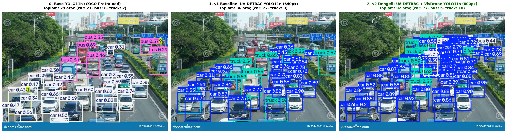
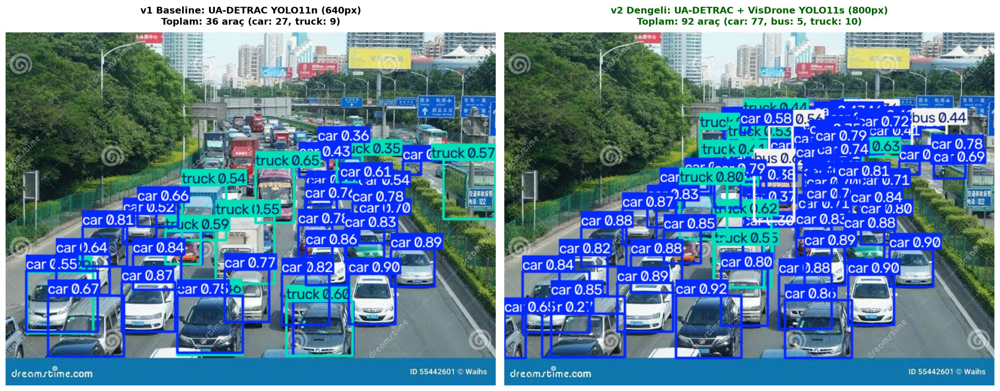
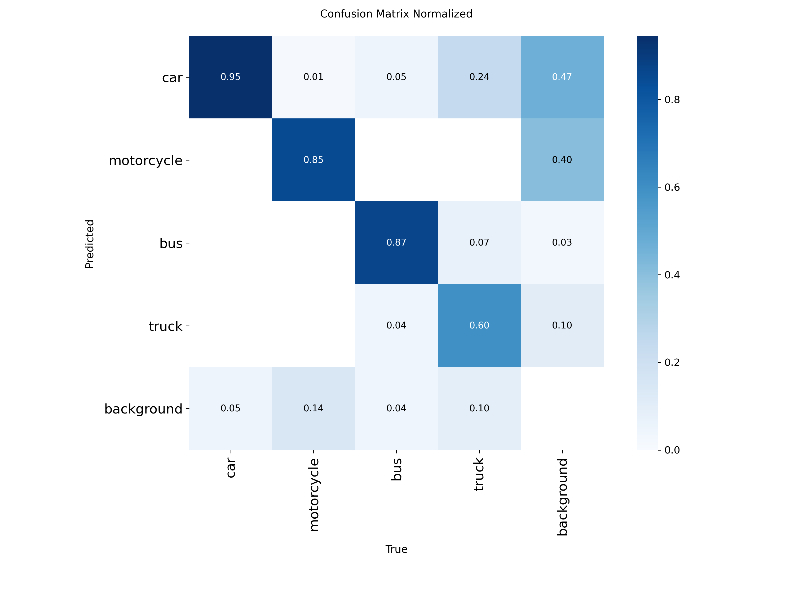
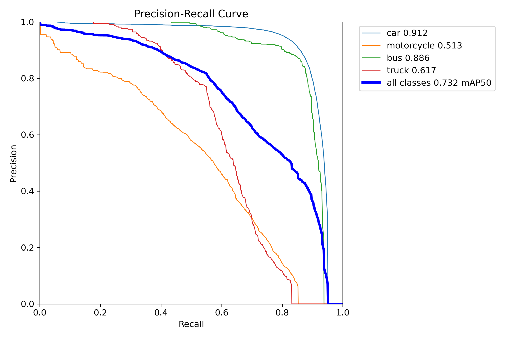
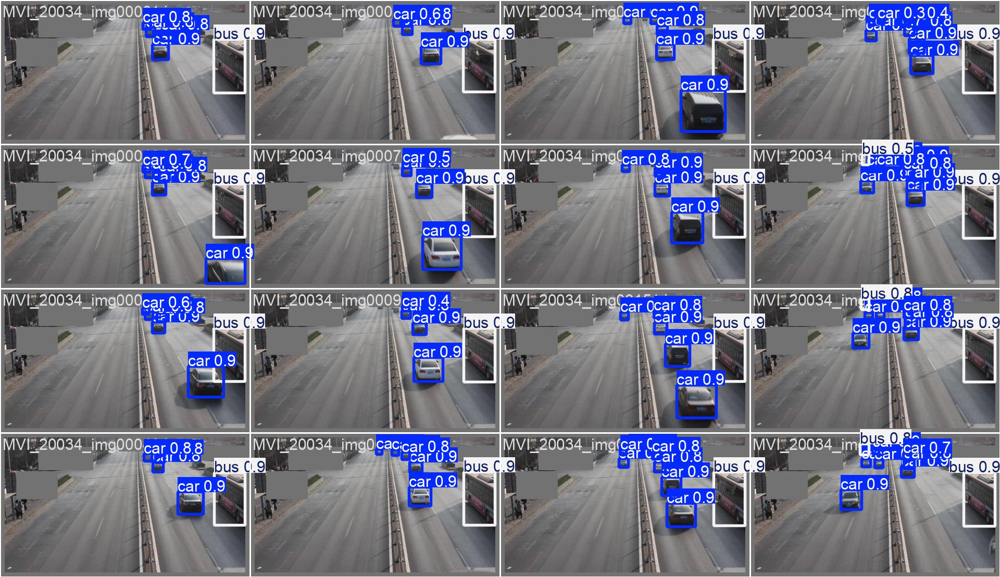

# 🚗 Federated Traffic Learning: YOLO11 Vehicle Detection with UA-DETRAC
## 🎓 Undergraduate Graduation Thesis Project

This project provides optimized **YOLO11 Nano** and **YOLO11 Small** vehicle detection models trained on real-world traffic surveillance imagery (**UA-DETRAC Benchmark** and **VisDrone2019-DET**) for Intelligent Transportation Systems (ITS), establishing the local edge-node detection backbone for our **Federated Learning** framework.

[](https://colab.research.google.com/github/aydin-eng/federated-traffic-learning/blob/main/traffic_vehicle_detection_yolo11.ipynb)
[](https://colab.research.google.com/github/aydin-eng/federated-traffic-learning/blob/main/traffic_vehicle_detection_balanced_yolo11.ipynb)
[](https://opensource.org/licenses/MIT)
[](https://docs.ultralytics.com/)
[](https://sites.google.com/view/daweidu/projects/ua-detrac)
[](https://www.python.org/)

---

## 📸 Model Comparison & Real-World Field Test (Base vs. v1 vs. v2)

Side-by-side evaluation of the standard COCO pretrained model (**Base YOLO11n**), our first-stage baseline (**v1 UA-DETRAC YOLO11n**), and our latest balanced multi-source model (**v2 Balanced YOLO11s, 800px**) on an independent real-world traffic scene (`test_samples/user_test_photo.jpg`, `conf=0.40`):



| Model | Total Detections | Class Breakdown | Max Confidence | Mean Confidence |
|---|---:|---|---:|---:|
| **0. Base YOLO11n (COCO, 640px)** | 18 vehicles | `15 car`, `3 bus`, `0 truck` | 0.818 | 0.572 |
| **1. v1 Baseline (UA-DETRAC YOLO11n, 640px)** | 31 vehicles | `24 car`, `7 truck`, `0 bus` | 0.904 | 0.678 |
| **2. v2 Balanced (UA-DETRAC + VisDrone YOLO11s, 800px)** | **63 vehicles** | **`52 car`, `8 truck`, `3 bus`** | **0.915** | **0.685** |

### 🔍 Comparative Analysis (Key Gains in v2)
* **2× More High-Confidence Detections (`31 → 63`):** Even at `conf=0.40`, the v2 model—powered by `imgsz=800`, the `YOLO11s` backbone, and elevated-angle VisDrone2019 data—reliably detects distant vehicles and the rear-lane truck convoy (`truck 0.80`, `truck 0.53`, `truck 0.49`, `truck 0.44`) that v1 missed completely.
* **Resolved Class Confusion (`bus` vs. `truck` vs. `car`):** Whereas v1 misclassified foreground passenger vehicles as `truck` (`0.46`) and the central passenger bus as `truck` (`0.65`) with zero bus detections, v2 accurately identifies the foreground vehicles as `car` (`0.92`, `0.86`) and recovers the buses as **`bus`** (`0.62`, `0.56`, `0.44`).
* **Close-Up v1 vs. v2 Comparison:** 

---

## 📈 Performance Metrics & Progression Table

Our latest **v2 Balanced Multi-Source** model (`weights/best_yolo11s_balanced.pt`) was trained on a Google Colab Tesla T4 GPU at `imgsz=800` for 46 epochs (Early Stopping `patience=15`), achieving its highest validation fitness at **Epoch 31**:

| Metric | Initial Stage (COCO Subset) | v1 Baseline (`YOLO11n`, 640px) | **v2 Balanced Multi-Source (`YOLO11s`, 800px — LATEST)** |
|---|---|---|---|
| **Training Data** | 12 Images (298 Augmented) | ~4,000+ Images (UA-DETRAC) | **8,007 Images** (4,407 UA-DETRAC + 3,600 VisDrone2019) |
| **Total Annotations** | ~1,200 Vehicle Boxes | ~40,000+ Vehicle Boxes | **161,838 Train Boxes** (`19,005` Val Boxes) |
| **Best Epoch** | — | 11 / 21 (`patience=10`) | **31 / 46** (`patience=15`) |
| **Precision** | 99.1% (Overfit) | **81.5% (0.8149)** | **77.4% (0.7741)** |
| **Recall** | 25.0% | 58.3% (0.5828) | **68.9% (0.6887)** *(+10.6 pts)* |
| **mAP@50 (Overall)** | 27.6% (0.2764) | 68.4% (0.6836) | **73.2% (0.7321)** *(+4.8 pts across all 4 classes)* |
| **mAP@50-95** | 13.5% (0.1349) | 49.1% (0.4914) | **51.9% (0.5187)** *(+2.7 pts)* |
| **Model Size** | 5.5 MB (`YOLO11n`) | 5.5 MB (`YOLO11n`) | **18.7 MB (`YOLO11s`)** |

### 🎯 Per-Class Performance Comparison (v1 vs. v2)

| Class | v1 Baseline mAP@50 | **v2 Precision** | **v2 Recall** | **v2 mAP@50** | **v2 mAP@50-95** | Improvement |
|---|---:|---:|---:|---:|---:|---|
| **`car`** | 0.863 | 0.8480 | 0.8861 | **0.9120** | 0.6489 | **+4.9 pts** |
| **`bus`** | 0.815 | 0.8700 | 0.8580 | **0.8861** | 0.7316 | **+7.1 pts** |
| **`truck`** | 0.374 | 0.7612 | 0.5506 | **0.6172** | 0.4646 | **+24.3 pts** *(850 Val boxes)* |
| **`motorcycle`** | 0.000 *(Absent)* | 0.6171 | 0.4602 | **0.5132** | 0.2297 | **0 → 51.3%** *(2,888 Val boxes)* |

---

## 📊 Training Curves & Evaluation Plots (v2 Balanced YOLO11s)

### 1. Loss & Metric Progression (Training & Validation Curves)
Progression of `box_loss`, `cls_loss`, `dfl_loss`, and validation mAP metrics across 46 epochs:


### 2. Confusion Matrix
Class discrimination performance across all 4 vehicle categories (`car`, `motorcycle`, `bus`, `truck`):

| Normalized Confusion Matrix | Raw Confusion Matrix |
|---|---|
|  |  |

### 3. Precision-Recall (PR), F1 Curves & Validation Predictions
Precision-recall trade-off across all classes (mAP@50 = **0.732**):

| Precision-Recall Curve | F1-Score Curve | Validation Prediction Sample |
|---|---|---|
|  |  |  |

---

## 🏷️ Vehicle Classes

| Class ID | Class Name | Description |
|---|---|---|
| **0** | `car` | Sedan, Hatchback, SUV, Minivan, Passenger Car |
| **1** | `motorcycle` | Motorcycle, Scooter |
| **2** | `bus` | Public Transit Bus, Coach, Shuttle Bus |
| **3** | `truck` | Truck, Heavy Commercial Vehicle, Pickup/Box Truck |

---

## ⚖️ Class-Imbalance Mitigation & Multi-Source Pipeline (v2 — YOLO11s)

Although the v1 UA-DETRAC run achieved 86.3% mAP@50 on `car`, forensic analysis revealed severe distribution bottlenecks: a **135:1** `car:truck` imbalance (`truck` mAP@50 = **0.374**), zero `motorcycle` annotations in UA-DETRAC, and false-positive background penalties caused by unmasked XML `<ignored_region>` boxes.

To address these issues, a modular v2 multi-source pipeline was implemented:

1. **Class-Aware Adaptive Sampling & `<ignored_region>` Masking (`src/data/prepare_balanced_dataset.py`):**
   * Replaced uniform `step=20` sampling with density-aware strides (`train_truck_step=2`, `train_bus_step=15`, `train_car_step=120`, `max_car_only=3`), reducing the UA-DETRAC `car:truck` ratio from **135:1 → 12.1:1** and increasing validation `truck` boxes from **17 → 337** and `bus` boxes from **66 → 484**.
   * Enforced a video-level **Stratified Split** (`49` train / `10` val sequences) with **0 sequence overlap** (zero data leakage).
   * Masked XML `<ignored_region>` boxes with neutral gray `(114, 114, 114)` while preserving valid labeled vehicle pixels, and exported per-frame sequence and weather metadata (`sunny`, `cloudy`, `night`, `rainy`) to `dataset_metadata.csv` for Federated Learning.
2. **VisDrone2019-DET Multi-Source Fusion (`src/data/fuse_external_vehicles.py`):**
   * Fused minority-vehicle frames (`motorcycle`, `truck`, `bus`; `max_train=1800`, `max_val=350`) from elevated traffic-camera **VisDrone2019-DET** scenes into the unified 4-class schema.
3. **Minority-Targeted Augmentation (`src/data/augment_minority.py`):**
   * Applied traffic-realistic transformations (`hflip`, `night`, `rainfog`, `sunlight`, `hsv`) exclusively to training frames containing `motorcycle` or `truck`, leaving `car`-only, `val`, and `test` splits untouched.
4. **Optimized YOLO11s Training (`traffic_vehicle_detection_balanced_yolo11.ipynb`):**
   * Trained `yolo11s.pt` at `imgsz=800` for 50 epochs (`cos_lr=True`, `lr0=0.005`, `cls=0.8`, `mixup=0.15`, `copy_paste=0.15`) with automated per-class evaluation (`per_class_metrics.json`).

---

## 🌐 Toward Federated Learning Integration

This local detection backbone serves as the foundation for the upcoming **Federated Learning** stage of the thesis:
1. **Local Edge Model:** Deployed across heterogeneous traffic cameras and intersections (edge clients) trained on private local streams.
2. **Privacy-Preserving Updates:** Raw surveillance footage never leaves the camera node; only model parameter updates are transmitted.
3. **Global Aggregation (FedAvg / FedProx):** Local updates are aggregated at the central server to build a generalized traffic detector robust across diverse weather and traffic conditions.

---

## 📁 Directory Structure

```text
federated-traffic-learning/
├── src/
│   └── data/
│       ├── prepare_balanced_dataset.py           # Adaptive UA-DETRAC extraction, ignored_region masking & FL metadata
│       ├── fuse_external_vehicles.py             # VisDrone2019-DET motorcycle/truck/bus fusion
│       └── augment_minority.py                   # Train-only minority class (motorcycle, truck) augmentation
├── weights/
│   ├── best_yolo11s_balanced.pt                  # v2 Balanced (UA-DETRAC + VisDrone2019) YOLO11s weights (~18.7 MB)
│   ├── best.pt                                   # v1 UA-DETRAC baseline weights (~5.5 MB)
│   └── last.pt                                   # v1 Last epoch weights
├── comparison_results/                           # Inference comparison visuals
│   ├── v2_vs_v1_vs_base_comparison.jpg           # 3-way field test: Base vs v1 vs v2 (LATEST)
│   ├── v2_vs_v1_comparison.jpg                   # Close-up comparison: v1 Baseline vs v2 Balanced YOLO11s
│   ├── pred_v2_balanced_yolo11s.jpg              # v2 Balanced model prediction output (63 vehicles, conf=0.40)
│   ├── detrac_vs_base_comparison.jpg             # v1 vs Pretrained Base comparison
│   ├── pred_detrac_yolo11n.jpg                   # v1 model prediction output
│   └── pred_base_yolo11n.jpg                     # Base model prediction output
├── test_samples/                                 # Independent test scenes
│   └── user_test_photo.jpg                       # Real-world traffic test image
├── training_results_v2_balanced/                 # v2 Balanced YOLO11s (46 Epochs) outputs & FL metadata
│   ├── per_class_metrics.json                    # Per-class precision, recall, and mAP records
│   ├── dataset_metadata.csv                      # 11,389-frame sequence & weather metadata for FL
│   ├── results.png                               # Training/validation loss and metric curves
│   ├── results.csv                               # Epoch-by-epoch numerical logs
│   ├── confusion_matrix_normalized.png           # Normalized confusion matrix
│   ├── BoxPR_curve.png                           # Precision-Recall curve
│   ├── BoxF1_curve.png                           # F1-score curve
│   └── args.yaml                                 # Ultralytics training hyperparameters
├── training_results/                             # v1 21-epoch baseline training outputs
├── traffic_vehicle_detection_yolo11.ipynb        # Baseline UA-DETRAC YOLO11n Colab notebook
├── traffic_vehicle_detection_balanced_yolo11.ipynb # Balanced v2 (UA-DETRAC + VisDrone2019) YOLO11s Colab notebook
├── detrac_xml_annotations.zip                    # Official UA-DETRAC XML annotations (93 video sequences)
├── yolo11_results.zip                            # Archived baseline training outputs from Colab
└── README.md                                     # Project documentation
```

---

## 🚀 Running Local Inference

To test the latest **`best_yolo11s_balanced.pt`** weights on your own traffic image or video:

```python
from ultralytics import YOLO

# Load the trained v2 balanced model
model = YOLO('weights/best_yolo11s_balanced.pt')

# Run inference on a traffic image (imgsz=800 matches training resolution)
results = model.predict(source='test_samples/user_test_photo.jpg', imgsz=800, conf=0.40, save=True)

# Print detected vehicles
for box in results[0].boxes:
    cls_id = int(box.cls[0])
    conf = float(box.conf[0])
    print(f"Detected: {model.names[cls_id]} - Confidence: {conf:.2f}")
```
