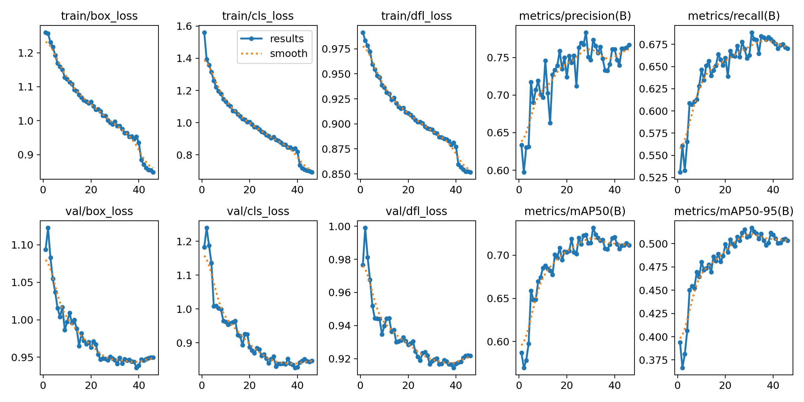
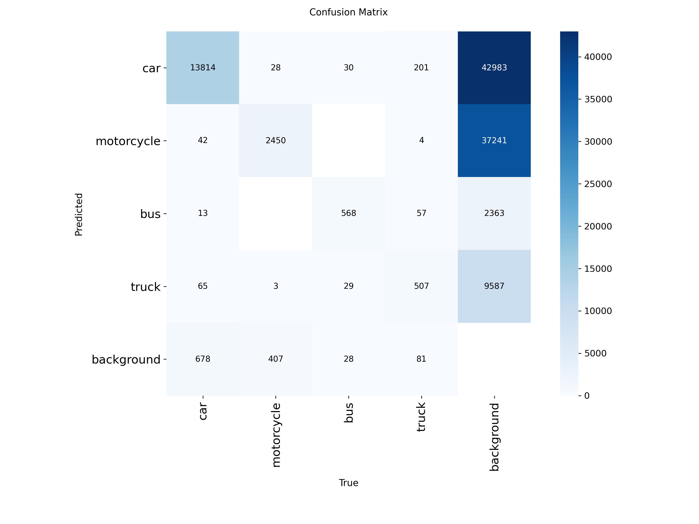
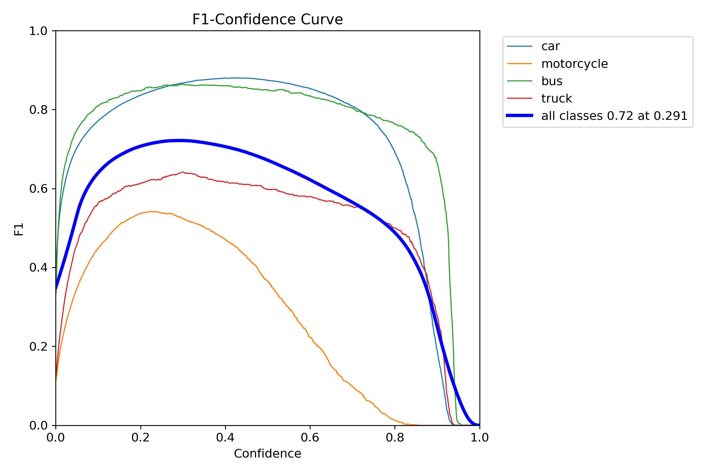

# 🚗 Federated Traffic Learning: UA-DETRAC ile YOLO11 Araç Tespiti
## 🎓 Lisans Bitirme Projesi (Graduation Thesis Project)

Bu proje; Akıllı Ulaşım Sistemleri (ITS) ve Trafik İzleme senaryoları için **gerçek trafik gözetleme kameralarından elde edilen UA-DETRAC Benchmark Veri Seti** üzerinde optimize edilmiş **YOLO11 Nano** modelini ve ilerleyen aşamalarda **Federal Öğrenme (Federated Learning)** mimarisinde kullanılacak temel yerel model altyapısını içermektedir.

[](https://colab.research.google.com/github/aydin-eng/federated-traffic-learning/blob/main/traffic_vehicle_detection_yolo11.ipynb)
[](https://colab.research.google.com/github/aydin-eng/federated-traffic-learning/blob/main/traffic_vehicle_detection_balanced_yolo11.ipynb)
[](https://opensource.org/licenses/MIT)
[](https://docs.ultralytics.com/)
[](https://sites.google.com/view/daweidu/projects/ua-detrac)
[](https://www.python.org/)

---

## 📸 Model Karşılaştırma ve Gerçek Saha Testi (Base vs. v1 vs. v2)

Standart COCO ağırlıklı temel model (**Base YOLO11n**), ilk aşama (**v1 UA-DETRAC YOLO11n**) ve en güncel (**v2 Dengeli Çoklu-Kaynak YOLO11s, 800px**) modelimizin bağımsız gerçek trafik sahnesindeki (`test_samples/user_test_photo.jpg`, `conf=0.40`) karşılaştırması:


| Model | Toplam Tespit | Sınıf Dağılımı | En Yüksek Güven | Ortalama Güven |
|---|---:|---|---:|---:|
| **0. Base YOLO11n (COCO, 640px)** | 18 araç | `15 car`, `3 bus`, `0 truck` | 0.818 | 0.572 |
| **1. v1 Baseline (UA-DETRAC YOLO11n, 640px)** | 31 araç | `24 car`, `7 truck`, `0 bus` | 0.904 | 0.678 |
| **2. v2 Dengeli (UA-DETRAC + VisDrone YOLO11s, 800px)** | **63 araç** | **`52 car`, `8 truck`, `3 bus`** | **0.915** | **0.685** |

### 🔍 Karşılaştırma Analizi (v2 ile Neler Kazanıldı?):
* **2× Daha Fazla Yüksek Güvenli Tespit (`31 → 63`):** `conf=0.40` eşiğinde dahi v2 modeli; `imgsz=800` çözünürlüğü, `YOLO11s` omurgası ve VisDrone2019 yüksek açı verisi sayesinde v1'in kaçırdığı arka şeritlerdeki uzak araçları ve kamyon konvoyunu (`truck 0.80`, `truck 0.53`, `truck 0.49`, `truck 0.44`) net biçimde yakaladı.
* **Sınıf Karışıklığının Giderilmesi (`bus` vs `truck` vs `car`):** v1 modelinin öndeki binek araçları hatalı `truck` (`0.46`) ve ortadaki pembe yolcu otobüsünü hatalı `truck` (`0.65`) etiketlediği sahnede; v2 modeli öndeki araçları doğru şekilde `car` (`0.92`, `0.86`), otobüsleri ise **`bus`** (`0.62`, `0.56`, `0.44`) olarak ayırt etti.
* **v1 vs v2 Yakın Plan Kıyaslama:** 

---

## 📈 Model Başarım Metrikleri ve Karşılaştırmalı Tablo

En güncel **v2 Dengeli Çoklu-Kaynak** modelimiz (`weights/best_yolo11s_balanced.pt`), Google Colab Tesla T4 GPU ortamında `imgsz=800` çözünürlükle 46 epoch boyunca eğitilmiş (Early Stopping `patience=15`) ve en yüksek fitness skoru **31. epoch**'ta elde edilmiştir:

| Metrik | İlk Aşama (COCO Alt Kümesi) | v1 Baseline (`YOLO11n`, 640px) | **v2 Dengeli Çoklu-Kaynak (`YOLO11s`, 800px — GÜNCEL)** |
|---|---|---|---|
| **Eğitim Verisi** | 12 Görsel (Artırımlı 298) | ~4.000+ Görsel (UA-DETRAC) | **8.007 Görsel** (4.407 UA-DETRAC + 3.600 VisDrone2019) |
| **Toplam Etiket Sayısı** | ~1.200 Araç Kutusu | ~40.000+ Araç Kutusu | **161.838 Train Kutusu** (`19.005` Val Kutusu) |
| **En İyi Epoch** | — | 11 / 21 (`patience=10`) | **31 / 46** (`patience=15`) |
| **Precision (Kesinlik)** | %99.1 (Overfit) | **%81.5 (0.8149)** | **%77.4 (0.7741)** |
| **Recall (Duyarlılık)** | %25.0 | %58.3 (0.5828) | **%68.9 (0.6887)** *(+10.6 Puan!)* |
| **mAP@50 (Genel Ortalama)** | %27.6 (0.2764) | %68.4 (0.6836) | **%73.2 (0.7321)** *(+4.8 Puan — 4 sınıf)* |
| **mAP@50-95 (Kapsamlı)** | %13.5 (0.1349) | %49.1 (0.4914) | **%51.9 (0.5187)** *(+2.7 Puan!)* |
| **Model Boyutu** | 5.5 MB (`YOLO11n`) | 5.5 MB (`YOLO11n`) | **18.7 MB (`YOLO11s`)** |

### 🎯 Sınıf Bazlı Başarım Karşılaştırması (Per-Class v1 vs v2)

| Sınıf | v1 Baseline mAP@50 | **v2 Precision** | **v2 Recall** | **v2 mAP@50** | **v2 mAP@50-95** | Gelişim |
|---|---:|---:|---:|---:|---:|---|
| **`car`** | 0.863 | 0.8480 | 0.8861 | **0.9120** | 0.6489 | **+4.9 Puan** |
| **`bus`** | 0.815 | 0.8700 | 0.8580 | **0.8861** | 0.7316 | **+7.1 Puan** |
| **`truck`** | 0.374 | 0.7612 | 0.5506 | **0.6172** | 0.4646 | **+24.3 Puan!** *(850 Val kutusu)* |
| **`motorcycle`** | 0.000 *(Yoktu)* | 0.6171 | 0.4602 | **0.5132** | 0.2297 | **Sıfırdan %51.3!** *(2.888 Val kutusu)* |

---

## 📊 Eğitim Grafikleri ve Metrik Eğrileri (v2 Dengeli YOLO11s)

### 1. Kayıp ve Metrik Gelişimi (Training & Validation Curves)
46 epochluk eğitim boyunca `box_loss`, `cls_loss`, `dfl_loss` kayıplarının düşüşü ve validation mAP eğrileri:



### 2. Karışıklık Matrisi (Confusion Matrix)
Modelin 4 araç sınıfını (`car`, `motorcycle`, `bus`, `truck`) ayrıştırma performansı:

| Normalize Karışıklık Matrisi | Ham Karışıklık Matrisi |
|---|---|
|  |  |

### 3. Precision-Recall (PR), F1 Eğrileri ve Validation Tahmin Örneği
Tüm sınıflar genelinde kesinlik-duyarlılık dengesi (mAP@50 = **0.732**):

| Precision-Recall Eğrisi | F1-Score Eğrisi | Validation Tahmin Örneği |
|---|---|---|
|  |  |  |

---

## 🏷️ Tespit Edilen Araç Sınıfları (Classes)

| Sınıf ID | Sınıf Adı | Açıklama |
|---|---|---|
| **0** | `car` | Otomobil, Sedan, Hatchback, SUV, Minibüs |
| **1** | `motorcycle` | Motosiklet, Scooter |
| **2** | `bus` | Toplu Taşıma, Belediye Otobüsü, Servis |
| **3** | `truck` | Kamyon, TIR, Ağır Vasıta, Kamyonet |

---

## ⚖️ Sınıf Dengesizliği Çözümü ve Çoklu-Kaynak Pipeline (v2 — YOLO11s)

İlk UA-DETRAC eğitiminde `car` sınıfında %86.3 mAP@50 elde edilmesine rağmen nadir sınıflarda veri dağılımı kaynaklı darboğazlar tespit edilmiştir (`car:truck` oranı **135:1**, `truck` mAP@50 **0.374**, UA-DETRAC içinde `motorcycle` etiketinin bulunmaması ve `<ignored_region>` alanlarının maskelenmemesi kaynaklı sahte arka plan cezaları).

Bu sorunları gidermek için modüler çoklu-kaynak eğitim pipeline'ı (`v2`) eklenmiştir:

1. **Akıllı Sınıf-Duyarlı Örnekleme ve `<ignored_region>` Maskeleme (`src/data/prepare_balanced_dataset.py`):**
   * Uniform `step=20` yerine sınıf yoğunluğuna duyarlı örnekleme (`train_truck_step=2`, `train_bus_step=15`, `train_car_step=120`, `max_car_only=3`) ile UA-DETRAC `car:truck` oranı **135:1 → 12.1:1** seviyesine indirilmiş, doğrulama kümesindeki `truck` kutu sayısı **17 → 337** ve `bus` kutu sayısı **66 → 484** düzeyine çıkarılmıştır.
   * Video sekansı bazlı katmanlı bölme (*Stratified Video Split*) ile `train` (49 sekans) ve `val` (10 sekans) arasında **0 sekans örtüşmesi** sağlanmıştır.
   * XML `<ignored_region>` alanları `(114, 114, 114)` nötr gri ile maskelenirken geçerli etiketli araç pikselleri korunur; sonraki Federated Learning aşaması için sekans ve hava durumu (`sunny`, `cloudy`, `night`, `rainy`) bilgileri `dataset_metadata.csv` olarak dışa aktarılır.
2. **VisDrone2019-DET Çoklu-Kaynak Füzyonu (`src/data/fuse_external_vehicles.py`):**
   * Yukarıdan trafik kamerası açısındaki **VisDrone2019-DET** veri setinden yalnızca azınlık sınıflar (`motorcycle`, `truck`, `bus`) içeren görseller (`max_train=1800`, `max_val=350`) 4-sınıf şemasına birleştirilir.
3. **Nadir Sınıf Odaklı Augmentation (`src/data/augment_minority.py`):**
   * Yalnızca `train` kümesindeki `motorcycle` ve `truck` karelerine trafik kamerasına özel dönüşümler (`hflip`, `night`, `rainfog`, `sunlight`, `hsv`) uygulanır; `car`-only karelere kopya üretilmez ve `val`/`test` kümelerine dokunulmaz.
4. **Optimize YOLO11s Eğitimi (`traffic_vehicle_detection_balanced_yolo11.ipynb`):**
   * Küçük motosiklet ve uzak kamyonları yakalamak için `yolo11s.pt`, `imgsz=800`, `epochs=50`, `cos_lr=True`, `lr0=0.005`, `cls=0.8`, `mixup=0.15`, `copy_paste=0.15` ile eğitilir ve sınıf bazlı metrikler `per_class_metrics.json` olarak raporlanır.

---

## 🌐 Federal Öğrenme (Federated Learning) Entegrasyonuna Doğru

Bu model, bitirme projesinin bir sonraki aşaması olan **Federal Öğrenme** mimarisinde:
1. **Yerel Model (Local Model):** Farklı kavşak ve trafik kameralarında (Edge node / İstemci) yerel verilerle eğitilecek olan omurga modelini temsil eder.
2. **Gizlilik Dostu Eğitim:** Kamera ham görüntüleri sunucuya gönderilmeksizin sadece ağırlık gradyanları paylaşılacaktır.
3. **Küresel Birleştirme (FedAvg / Aggregation):** Eğitilen yerel modeller merkezi sunucuda birleştirilerek her türlü hava koşuluna ve trafik yoğunluğuna dayanıklı genel bir trafik zekası oluşturulacaktır.

---

## 📁 Proje Dizin Yapısı (Directory Structure)

```text
federated-traffic-learning/
├── src/
│   └── data/
│       ├── prepare_balanced_dataset.py           # Adaptive UA-DETRAC çıkarımı, ignored_region maskeleme ve FL metadata
│       ├── fuse_external_vehicles.py             # VisDrone2019-DET motorcycle/truck/bus füzyonu
│       └── augment_minority.py                   # Yalnızca nadir sınıflar (motorcycle, truck) için train augmentation
├── weights/
│   ├── best_yolo11s_balanced.pt                  # v2 Dengeli (UA-DETRAC + VisDrone2019) YOLO11s modeli (~18.7 MB)
│   ├── best.pt                                   # v1 UA-DETRAC baseline modeli (~5.5 MB)
│   └── last.pt                                   # v1 Son epoch ağırlığı
├── comparison_results/                           # Çıkarım karşılaştırma görselleri
│   ├── v2_vs_v1_vs_base_comparison.jpg           # Base vs v1 vs v2 3'lü saha kıyaslaması (GÜNCEL)
│   ├── v2_vs_v1_comparison.jpg                   # v1 Baseline vs v2 Dengeli YOLO11s kıyaslaması
│   ├── pred_v2_balanced_yolo11s.jpg              # v2 Dengeli model tahmin çıktısı (63 araç, conf=0.40)
│   ├── detrac_vs_base_comparison.jpg             # v1 vs Pretrained Base kıyaslaması
│   ├── pred_detrac_yolo11n.jpg                   # v1 model tahmin çıktısı
│   └── pred_base_yolo11n.jpg                     # Base model tahmin çıktısı
├── test_samples/                                 # Bağımsız test fotoğrafları
│   └── user_test_photo.jpg                       # Gerçek trafik test fotoğrafı
├── training_results_v2_balanced/                 # v2 Dengeli YOLO11s (46 Epoch) çıktıları ve FL metadata
│   ├── per_class_metrics.json                    # Sınıf bazlı kesinlik/duyarlılık/mAP kayıtları
│   ├── dataset_metadata.csv                      # 11.389 karelik sekans & hava koşulu FL metaverisi
│   ├── results.png                               # Epoch metrik ve kayıp grafikleri
│   ├── results.csv                               # Sayısal metrik kayıtları
│   ├── confusion_matrix_normalized.png           # Normalize edilmiş karışıklık matrisi
│   ├── BoxPR_curve.png                           # Precision-Recall eğrisi
│   ├── BoxF1_curve.png                           # F1 eğrisi
│   └── args.yaml                                 # Ultralytics eğitim hiperparametreleri
├── training_results/                             # v1 21 Epochluk baseline eğitim çıktıları
├── traffic_vehicle_detection_yolo11.ipynb        # Baseline UA-DETRAC YOLO11n Colab notebook'u
├── traffic_vehicle_detection_balanced_yolo11.ipynb # Dengeli v2 (UA-DETRAC + VisDrone2019) YOLO11s Colab notebook'u
├── detrac_xml_annotations.zip                    # 93 video dizisine ait resmi XML etiketleri
├── yolo11_results.zip                            # Colab'dan indirilen baseline eğitim çıktıları
└── README.md                                     # Kapsamlı proje dokümantasyonu
```

---

## 🚀 Modeli Yerelde Çalıştırma (Inference)

Eğitilen en güncel **`best_yolo11s_balanced.pt`** ağırlıklarını kendi görsel veya videonuzda test etmek için:

```python
from ultralytics import YOLO

# Eğitilmiş v2 dengeli modeli yükle
model = YOLO('weights/best_yolo11s_balanced.pt')

# Herhangi bir trafik görselinde çıkarım yap (imgsz=800 ile eğitildiği için 800 önerilir)
results = model.predict(source='test_samples/user_test_photo.jpg', imgsz=800, conf=0.25, save=True)

# Tespit edilen araçları yazdır
for box in results[0].boxes:
    cls_id = int(box.cls[0])
    conf = float(box.conf[0])
    print(f"Tespit: {model.names[cls_id]} - Güven: {conf:.2f}")
```
