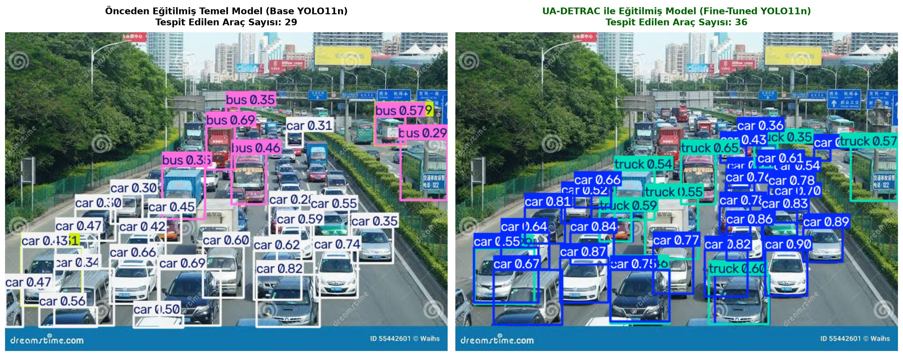
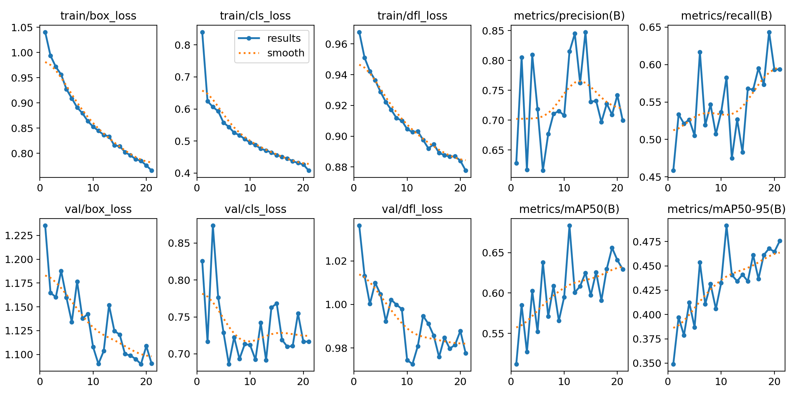
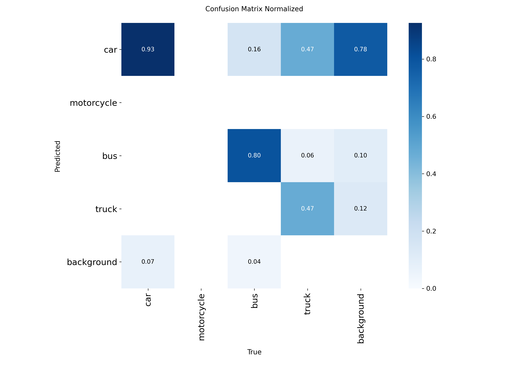
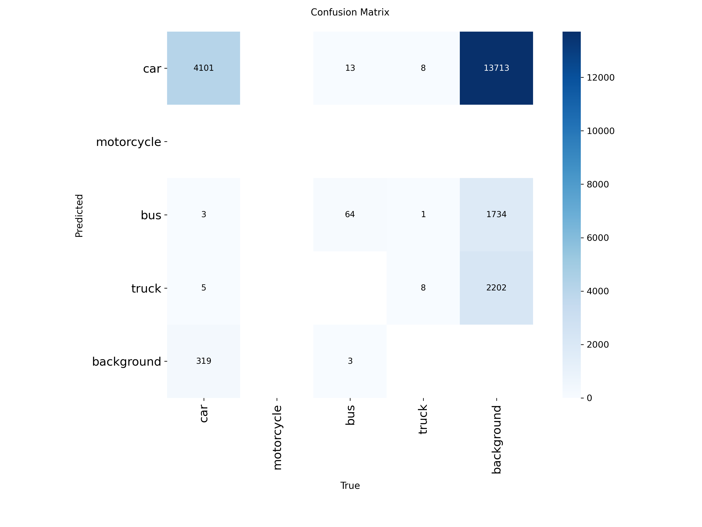
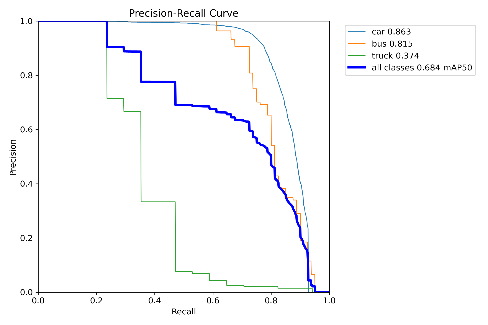
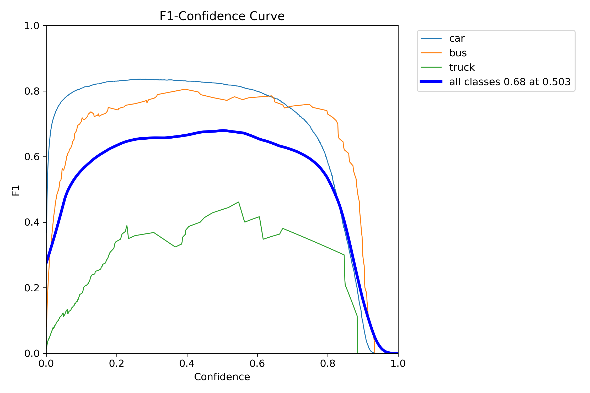

# 🚗 Federated Traffic Learning: UA-DETRAC ile YOLO11 Araç Tespiti
## 🎓 Lisans Bitirme Projesi (Graduation Thesis Project)

Bu proje; Akıllı Ulaşım Sistemleri (ITS) ve Trafik İzleme senaryoları için **gerçek trafik gözetleme kameralarından elde edilen UA-DETRAC Benchmark Veri Seti** üzerinde optimize edilmiş **YOLO11 Nano** modelini ve ilerleyen aşamalarda **Federal Öğrenme (Federated Learning)** mimarisinde kullanılacak temel yerel model altyapısını içermektedir.

[](https://colab.research.google.com/github/aydin-eng/federated-traffic-learning/blob/main/traffic_vehicle_detection_yolo11.ipynb)
[](https://opensource.org/licenses/MIT)
[](https://docs.ultralytics.com/)
[](https://sites.google.com/view/daweidu/projects/ua-detrac)
[](https://www.python.org/)

---

## 📸 Model Karşılaştırma ve Gerçek Saha Testi (Before vs. After)

Standart COCO ağırlıklı temel model (**Base YOLO11n**) ile gerçek trafik gözetleme kamerası açılarından oluşan **UA-DETRAC veri seti** üzerinde eğittiğimiz modelimizin bağımsız gerçek trafik sahnesindeki karşılaştırması:



### 🔍 Karşılaştırma Analizi:
* **Base YOLO11n (Pretrained COCO):** 29 araç tespit etti. Uzaktaki araçları ve yoğun şeritleri kaçırdı; bazı minibüs ve ticari araçları hatalı otobüs sınıflandırması yaptı. En yüksek güven skoru 0.82 oldu.
* **UA-DETRAC Fine-Tuned Model:** **36 araç tespit etti!** (+7 araç farkı). Kamera açısından uzaklaşan ve kısmen örtüşen (occluded) araçları başarıyla yakaladı. Güven skoru **0.90** seviyesine ulaştı ve kamyon/ağır vasıta sınıflandırması çok daha kararlı hale geldi.

---

## 📈 Model Başarım Metrikleri ve Karşılaştırmalı Tablo

Modelimiz, Google Colab Tesla T4 GPU ortamında 21 epoch boyunca eğitilmiş ve en yüksek mAP skoru 11. epoch'ta elde edilerek `best.pt` olarak kaydedilmiştir:

| Metrik | İlk Aşama (COCO Alt Kümesi) | **Yeni UA-DETRAC Modeli (GÜNCEL)** | Gelişim / İlerleme |
|---|---|---|---|
| **Eğitim Verisi** | 12 Görsel (Veri artırımlı 298) | **~4.000+ Gerçek Trafik Görseli** | **~14x Veri Hacmi** |
| **Toplam Etiket Sayısı**| ~1.200 Araç Kutusu | **~40.000+ Gerçek Araç Kutusu** | **~33x Daha Fazla Örnek** |
| **Precision (Kesinlik)** | %99.1 (Aşırı ezber/Overfit) | **%81.5 (0.8149)** | Dengeli ve gerçekçi genelleme |
| **Recall (Duyarlılık)** | %25.0 (Çoğu aracı kaçırıyordu) | **%58.3 (0.5828)** | **+33.3 Puan Artış!** |
| **mAP@50 (Ortalama Başarı)**| %27.6 (0.2764) | **%68.4 (0.6836)** | **+%40.8 Puan Artış (2.5 Kat!)** |
| **mAP@50-95 (Kapsamlı Başarı)**| %13.5 (0.1349) | **%49.1 (0.4914)** | **+%35.6 Puan Artış (3.6 Kat!)** |
| **Model Boyutu** | 5.5 MB (YOLO11n) | **5.5 MB (YOLO11n)** | Edge/IoT cihazlara tam uyumlu |

---

## 📊 Eğitim Grafikleri ve Metrik Eğrileri

### 1. Kayıp ve Metrik Gelişimi (Training & Validation Curves)
Eğitim süresince `box_loss`, `cls_loss`, `dfl_loss` kayıplarının düzenli düşüşü ve validation mAP değerlerinin yükselişi:



### 2. Karışıklık Matrisi (Confusion Matrix)
Modelin araç sınıflarını (`car`, `bus`, `truck`) ayrıştırma ve arka plan (background) ayrımı:

| Normalize Karışıklık Matrisi | Ham Karışıklık Matrisi |
|---|---|
|  |  |

### 3. Precision-Recall (PR) & F1 Skoru Eğrileri
Tüm sınıflar genelinde kesinlik-duyarlılık dengesi:

| Precision-Recall Eğrisi (mAP@50 = 0.684) | F1-Score Eğrisi |
|---|---|
|  |  |

---

## 🏷️ Tespit Edilen Araç Sınıfları (Classes)

| Sınıf ID | Sınıf Adı | Açıklama |
|---|---|---|
| **0** | `car` | Otomobil, Sedan, Hatchback, SUV, Minibüs |
| **1** | `motorcycle` | Motosiklet, Scooter |
| **2** | `bus` | Toplu Taşıma, Belediye Otobüsü, Servis |
| **3** | `truck` | Kamyon, TIR, Ağır Vasıta, Kamyonet |

---

## 🌐 Federal Öğrenme (Federated Learning) Entegrasyonuna Doğru

Bu model, bitirme projesinin bir sonraki aşaması olan **Federal Öğrenme** mimarisinde:
1. **Yerel Model (Local Model):** Farklı kavşak ve trafik kameralarında (Edge node / İstemci) yerel verilerle eğitilecek olan omurga modelini temsil eder.
2. **Gizlilik Dostu Eğitim:** Kamera ham görüntüleri sunucuya gönderilmeksizin sadece ağırlık gradyanları paylaşılacaktır.
3. **Küresel Birleştirme (FedAvg / Aggregation):** Eğitilen yerel modeller merkezi sunucuda birleştirilerek her türlü hava koşuluna ve trafik yoğunluğuna dayanıklı genel bir trafik zekası oluşturulacaktır.

---

## 📁 Proje Dizin Yapısı (Directory Structure)

```text
federated-traffic-learning/
├── weights/
│   ├── best.pt                             # UA-DETRAC ile eğitilmiş en başarılı model (~5.5 MB)
│   └── last.pt                             # Son epoch ağırlığı
├── comparison_results/                     # Çıkarım karşılaştırma görselleri
│   ├── detrac_vs_base_comparison.jpg       # Yeni model vs Pretrained Base kıyaslaması
│   ├── pred_detrac_yolo11n.jpg             # Yeni model tahmin çıktısı
│   └── pred_base_yolo11n.jpg               # Base model tahmin çıktısı
├── test_samples/                           # Bağımsız test fotoğrafları
│   └── user_test_photo.jpg                 # Gerçek trafik test fotoğrafı
├── training_results/                       # 21 Epochluk eğitim çıktıları ve analiz grafikleri
│   ├── results.png                         # Epoch metrik ve kayıp grafikleri
│   ├── results.csv                         # Sayısal metrik kayıtları
│   ├── confusion_matrix_normalized.png     # Normalize edilmiş karışıklık matrisi
│   ├── BoxPR_curve.png                     # Precision-Recall eğrisi
│   ├── BoxF1_curve.png                     # F1 eğrisi
│   └── args.yaml                           # Ultralytics eğitim hiperparametreleri
├── traffic_vehicle_detection_yolo11.ipynb  # Google Colab GPU uçtan uca eğitim notebook'u
├── detrac_xml_annotations.zip              # 93 video dizisine ait resmi XML etiketleri
├── yolo11_results.zip                      # Colab'dan indirilen paketlenmiş eğitim çıktıları
└── README.md                               # Kapsamlı proje dokümantasyonu
```

---

## 🚀 Modeli Yerelde Çalıştırma (Inference)

Eğitilen en güncel `best.pt` ağırlıklarını kendi görsel veya videonuzda test etmek için:

```python
from ultralytics import YOLO

# Eğitilmiş modeli yükle
model = YOLO('weights/best.pt')

# Herhangi bir trafik görselinde çıkarım yap
results = model.predict(source='test_samples/user_test_photo.jpg', conf=0.25, save=True)

# Tespit edilen araçları yazdır
for box in results[0].boxes:
    cls_id = int(box.cls[0])
    conf = float(box.conf[0])
    print(f"Tespit: {model.names[cls_id]} - Güven: {conf:.2f}")
```
