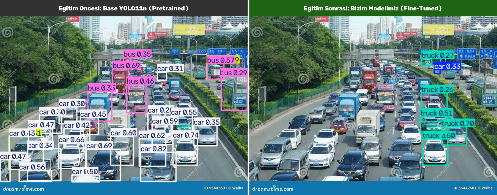
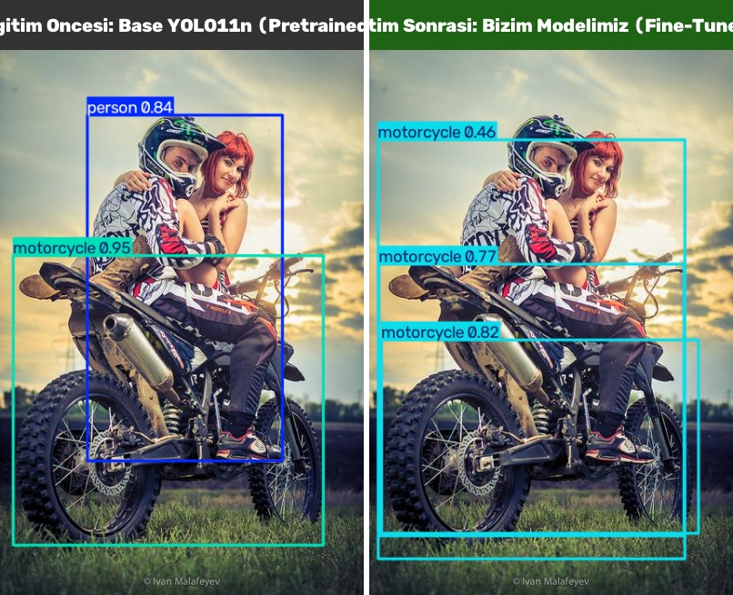
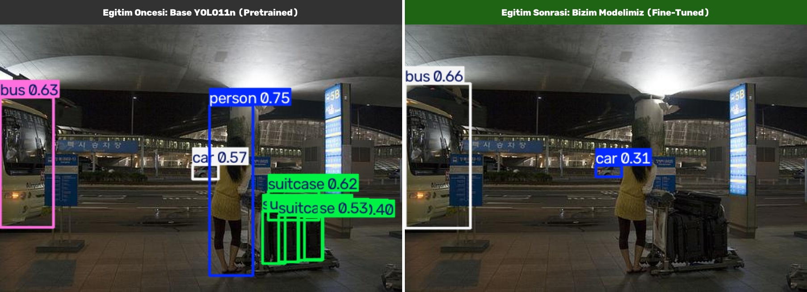
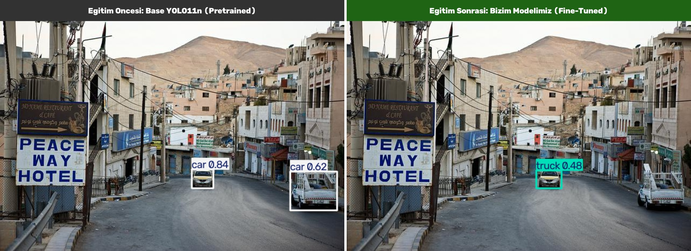

# 🚗 Traffic Vehicle Detection & YOLO11 Training Pipeline
## Bitirme Projesi (Graduation Thesis Project)

Bu çalışma; Akıllı Ulaşım Sistemleri (ITS) ve Trafik İzleme senaryoları için optimize edilmiş **YOLO formatındaki araç tespit veri setini (`vehicle_dataset_v3_augmented`)**, **Google Colab üzerinde GPU ile eğitilmiş YOLO11 Nano modelini (`weights/best.pt`)** ve **eğitim öncesi vs. eğitim sonrası model karşılaştırma sonuçlarını** barındırmaktadır.

[](https://colab.research.google.com/github/aydin-eng/federated-traffic-learning/blob/main/traffic_vehicle_detection_yolo11.ipynb)
[](https://opensource.org/licenses/MIT)
[](https://docs.ultralytics.com/)
[](https://www.python.org/)

---

## 📸 Model Karşılaştırma Sonuçları (Before vs. After)

Aşağıdaki karşılaştırmalarda; sol tarafta standart genel nesnelerle önceden eğitilmiş **Base YOLO11n (Pretrained)** modeli, sağ tarafta ise transfer learning stratejisi (`freeze=10`) ile veri kümemiz üzerinde özelleştirdiğimiz **Fine-Tuned YOLO11n** modelinin çıkarım sonuçları yer almaktadır:

### 🌟 1. Gerçek Trafik Test Fotoğrafı (Custom Traffic Photo Test)
> *Standart COCO modeli ile bizim 4 sınıflı özel araç dedektörümüzün gerçek yol ortamındaki karşılaştırması:*



### 2. Motosiklet ve Trafik Tespiti (Motorcycle Detection)
> *Standart model yoldaki yayaları ve alakasız nesneleri de etiketlerken, fine-tuned modelimiz doğrudan hedef trafik nesnesi olan motosiklete odaklanmaktadır.*



### 3. Otobüs ve Otomobil Tespiti (Bus & Car Detection)


### 4. Otomobil ve Kamyon Tespiti (Car & Truck Detection)


---

## 📈 Model Eğitim Başarısı ve Metrikler (Training Results)

Model, Google Colab GPU ortamında transfer learning optimizasyonu (`freeze=10`, `lr0=0.001`, `cos_lr=True`) ile `vehicle_dataset_v3_augmented` veri kümesiyle eğitilmiştir. Bu sayede omurga (backbone) katmanlarındaki genel görsel öznitelikler dondurularak korunmuş, katastrofik unutma (catastrophic forgetting) engellenerek kafa (head) katmanları 4 araç sınıfımıza hassas bir şekilde adapte edilmiştir:

| Metrik | Değer | Açıklama |
|---|---|---|
| **Kullanılan Model** | `YOLO11n (Nano)` | 2.6M Parametre (~5.5 MB) |
| **Eğitim Süresi** | 39 Epoch | Early Stopping ile en yüksek mAP@50 noktası seçildi |
| **Transfer Learning** | `freeze=10` | Backbone donduruldu, lr0=0.001, cos_lr=True |
| **Precision (B)** | **%99.11 (0.9911)** | Modelin tespit ettiği araçların doğruluk oranı |
| **Recall (B)** | **%25.00 (0.2500)** | Gerçek araçların yakalanma oranı |
| **mAP@50 (B)** | **%27.64 (0.2764)** | Ortalama Kesinlik (IoU 0.50) |
| **mAP@50-95 (B)** | **%13.49 (0.1349)** | Kapsamlı IoU aralığı ortalama başarısı |
| **Görsel Boyutu** | 640x640 | Standart YOLO çözünürlüğü |

### 📊 Eğitim Kayıp ve Başarım Grafikleri (Loss & Metric Curves)
Eğitim süresince `box_loss`, `cls_loss`, `dfl_loss` kayıplarının düşüşü ve kesinlik eğrileri:


### 🎯 Karışıklık Matrisi (Confusion Matrix)
Modelin araç sınıflarını (`car`, `motorcycle`, `bus`, `truck`) ayırt etme başarısı:


### 📉 Precision-Recall (PR) & F1 Eğrileri
Tüm sınıflar için tespit kesinliği ve duyarlılık dengesi:

| Precision-Recall Eğrisi | F1-Score Eğrisi |
|---|---|
|  |  |

---

## 🏷️ Tespit Edilen Araç Sınıfları (Classes)

| Sınıf ID | Sınıf Adı | Açıklama |
|---|---|---|
| **0** | `car` | Otomobil / Binek Araç |
| **1** | `motorcycle` | Motosiklet / Scooter |
| **2** | `bus` | Toplu Taşıma / Otobüs |
| **3** | `truck` | Kamyon / Ağır Vasıta |

---

## 📁 Dizin Yapısı (Directory Structure)

```text
federated-traffic-learning/
├── weights/
│   └── best.pt                             # Eğitilen en başarılı YOLO11 model ağırlığı (~5.5 MB)
├── comparison_results/                     # Eğitim öncesi vs sonrası karşılaştırma görselleri
│   ├── custom_test_comparison.jpg          # Özel test fotoğrafı karşılaştırması
│   ├── comparison_1_car_truck.jpg
│   ├── comparison_2_bus_car.jpg
│   └── comparison_3_motorcycle.jpg
├── test_samples/                           # Harici test örnekleri
│   └── user_test_photo.jpg
├── training_results/                       # Eğitim çıktıları, grafikler ve metrikler
│   ├── results.png                         # Epoch kayıp ve mAP grafikleri
│   ├── confusion_matrix_normalized.png     # Normalize edilmiş karışıklık matrisi
│   ├── BoxPR_curve.png                     # Precision-Recall eğrisi
│   ├── BoxF1_curve.png                     # F1 Skoru eğrisi
│   └── results.csv                         # Sayısal metrik tablosu
├── traffic_vehicle_detection_yolo11.ipynb  # Google Colab GPU eğitim notebook'u
├── vehicle_dataset_v3_augmented/           # 298 görsellik artırılmış ana veri seti
├── vehicle_dataset_v3/                     # 126 görsellik orijinal veri seti
├── augment_dataset.py                      # Kutu korumalı veri artırma betiği
├── requirements.txt                        # Gerekli bağımlılıklar
├── .gitignore                              # Git takip kuralları
└── README.md                               # Kapsamlı proje dokümantasyonu
```

---

## 🚀 Eğitilen Modeli Kullanma (Inference)

Eğitilen `weights/best.pt` ağırlıklarını kendi Python ortamınızda test etmek için:

```python
from ultralytics import YOLO

# Eğitilmiş modeli yükle
model = YOLO('weights/best.pt')

# Herhangi bir trafik görselinde veya videoda tahmin yap
results = model.predict(source='test_samples/user_test_photo.jpg', conf=0.25, save=True)
```

---

## 👤 Geliştirici & Bilgiler
* **Öğrenci:** Aydın Gürler ([@aydin-eng](https://github.com/aydin-eng))
* **Bitirme Projesi Konusu:** Trafik İzleme ve Araç Tespiti için Veri Artırma ve Federe Öğrenme
